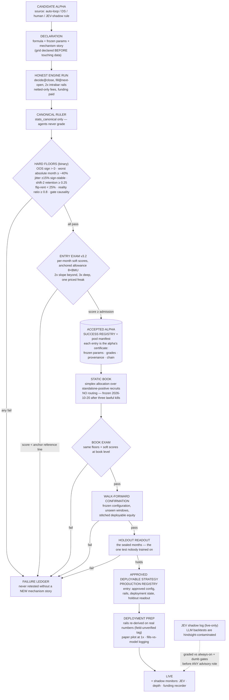

# The Alpha Lifecycle — from candidate to deployable strategy

*Standing process documentation (2026-10-23, JP-requested). The laws referenced live in
RESEARCH_LEDGER.md (2026-10-19 constitution) and tools/stats_canonical.py.*

## Stage notes

- **Declaration before data** kills the silent overfit; the failure ledger makes rejections
  permanent knowledge unless a genuinely new mechanism justifies a retest.
- **The anchor** (raw latch, net) runs through every exam as the reference line: any bar the
  anchor cannot pass is wrong by definition.
- **Gate variants** (funding gate, BTC-momentum gate — e.g. alpha_076c) enter as ordinary
  candidates whose parent is the anchor; the exam decides whether conditioning adds or subtracts.
- **Routing is closed** at pool-size 1: with multiple standalone-positive recruits the static
  simplex reopens automatically; adaptive routing stays buried absent new evidence.
- **Holdout discipline**: the sealed months are read once, on the frozen configuration. They are
  the transition from "accepted" to "approved."
- **Where successes live**: the **pool manifest** (`data/precompute/manifest.json`) is the
  machine-readable success registry — every accepted alpha's entry is its certificate (frozen
  params, canonical grades, provenance, supersession chain — see alpha_076a replacing 076).
  **Approved deployables** get a production-registry entry (approved configuration, rails,
  holdout readout). The narrative ledger records both, but the manifests are the durable
  certificates. Failures need their dedicated ledger because they otherwise evaporate;
  successes persist structurally — in the manifest, the code, and the deployed config.
